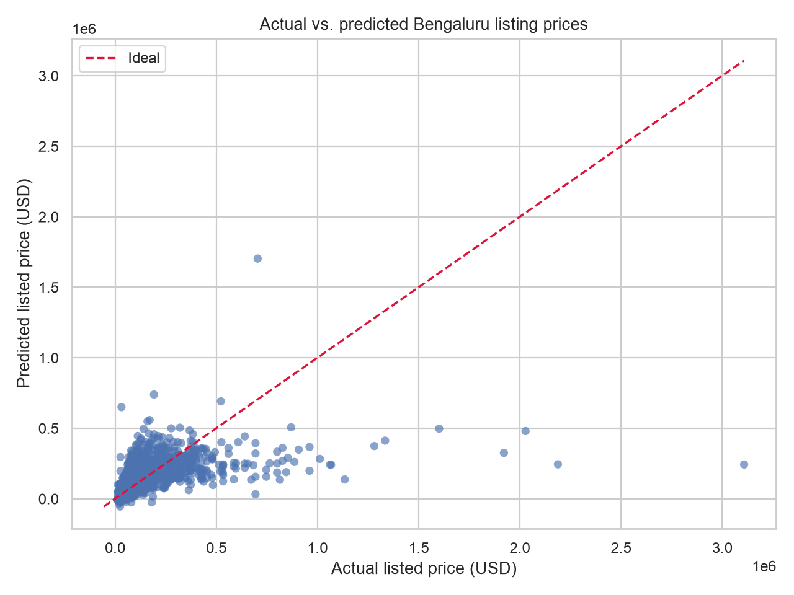
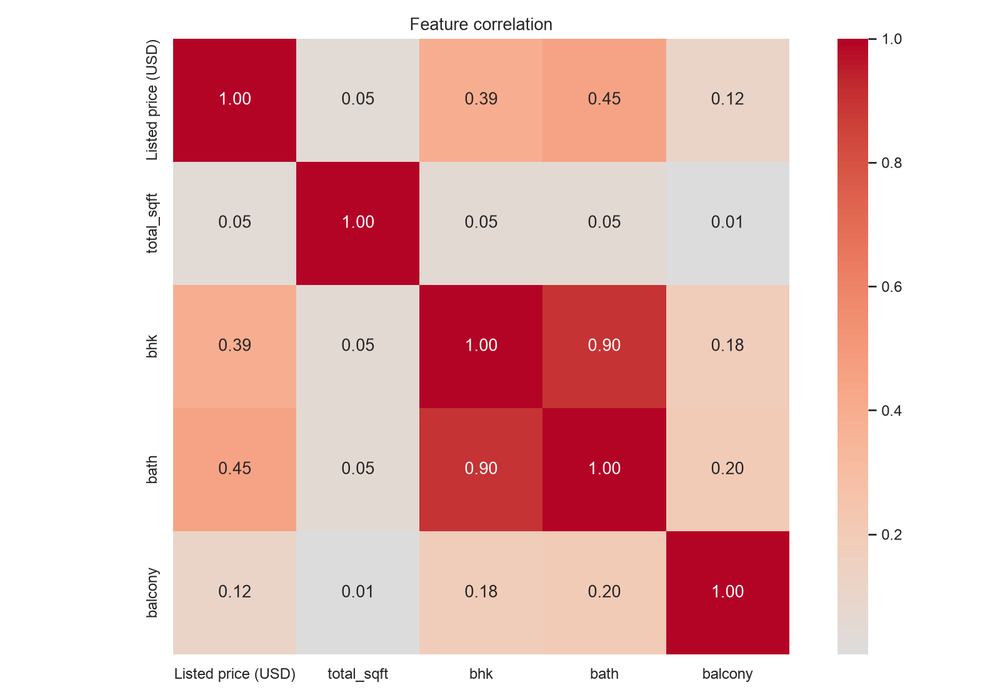
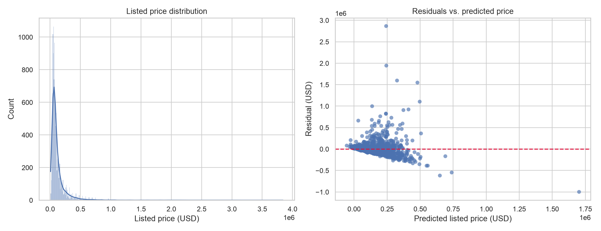

# HomiQ: Bengaluru House Price Prediction

HomiQ is an end-to-end educational real-estate analytics project. It uses a
leakage-safe scikit-learn Linear Regression pipeline to estimate historical
Bengaluru property listing prices and a Streamlit app to explore the results.
**All prices presented in the application, charts, and generated visual reports
are in USD.** The model trains and evaluates against the original INR target;
currency conversion is strictly a presentation step.

> **Scope:** This release is Bengaluru-only. It does not cover Delhi NCR,
> Mumbai, or other Indian cities, and it is not a current-market appraisal,
> financial advice, or a confidence-calibrated valuation.

## Dataset and units

The project uses the public
[Bengaluru House Price Data dataset on Kaggle](https://www.kaggle.com/datasets/amitabhajoy/bengaluru-house-price-data)
(dataset 20710, creator AmitabhaChakraborty, **CC0: Public Domain**). The
source file contains 13,320 Bengaluru listing records and columns for locality,
area type, size, total area, bathrooms, balconies, and price. It is not a
multi-city dataset.

On the first training run, HomiQ retrieves a pinned copy of the CC0 source file
and verifies its SHA-256 digest before caching it at
`data/raw/Bengaluru_House_Data.csv`. You can also download the CSV from Kaggle
and place it at that path. The loader:

- converts supported area units and area ranges to square feet;
- extracts BHK/bedroom counts and excludes non-BHK `RK` records;
- converts the source's lakh-rupee prices to the INR model target;
- drops invalid targets, missing locations, unusable areas/sizes, and exact
  duplicates during training; and
- reports outliers rather than automatically deleting potentially valid homes.

The source does not establish a reliable current-market date. Treat its
predictions as historical listing estimates only.

## USD display and exchange rate

The model's target and every model-evaluation calculation remain in INR. The
Streamlit UI and generated price visualizations convert those amounts to USD
after prediction or evaluation. Price per square foot, locality medians, MAE,
RMSE, MSE, chart axes, and permutation-importance values use USD display units;
R² is unitless. MSE is scaled by the square of the exchange rate.

HomiQ requests the latest available daily INR/USD rate from
[Frankfurter](https://www.frankfurter.dev/) and caches it for one hour. If the
service is unavailable, the app clearly indicates it is using the configurable
fallback rate. Set `HOMIQ_USD_PER_INR` to a positive USD-per-INR rate between
`0.001` and `0.1`; the default fallback is `0.012`.

The app displays: “Prices displayed in USD. Converted from INR using the latest
available exchange rate.” It also shows the rate source and date. The exchange
rate never changes model training, predictions in INR, or model evaluation.

## Project layout

```text
HomiQ/
├── app.py                         # Streamlit overview, estimator, and insights
├── train.py                       # Train model and generate reports
├── .streamlit/config.toml          # Light HomiQ theme
├── homiq/
│   ├── data.py                    # Dataset loading, normalization, and EDA
│   ├── modeling.py                # Preprocessing pipeline and metrics
│   ├── currency.py                # Live/fallback INR-to-USD display conversion
│   ├── analytics.py               # USD Plotly charts and filters
│   ├── ui.py                      # HomiQ design theme and reusable UI elements
│   └── train.py                   # Training, evaluation, plots, artifacts
├── notebooks/
│   └── house_price_prediction.ipynb
├── data/raw/                      # Downloaded dataset (not committed)
├── models/                        # Trained pipeline (generated)
├── reports/                       # INR metrics and USD visualizations
└── requirements.txt
```

## Setup and run locally

Python 3.9 or newer is recommended.

```bash
python -m venv .venv
source .venv/bin/activate          # Windows: .venv\Scripts\activate
python -m pip install --upgrade pip
pip install -r requirements.txt
python train.py
streamlit run app.py
```

The first training run needs internet access to download the dataset. The app
does not retrain the model on each page visit. If internet is unavailable after
the dataset has been cached, training and the app continue to work; USD display
uses the configured fallback rate.

## Platform interface

- **Overview:** dataset scope, measured test-set R² and USD-converted error.
- **Price estimator:** type-to-search Bengaluru locality, property area in
  square feet, bedrooms/BHK, bathrooms, balconies, and area type.
- **Market insights:** interactive USD actual-versus-predicted and price
  distribution charts, feature correlations, USD-converted model metrics, and
  held-out permutation importance. Filters use the available locality, area
  type, and BHK data.

No prediction confidence interval is shown: this model has not been calibrated
to support one.

## Methodology

1. **Explore:** inspect dimensions, columns, data types, descriptive
   statistics, missing values, exact duplicates, IQR-based outliers, and
   numeric correlations.
2. **Prepare:** normalize area and size fields, drop records without a valid
   target or required predictors, and retain valid outliers for reporting.
3. **Split:** reserve a fixed random 20% test partition. Compare a numeric
   baseline with a richer model using five-fold cross-validation on the
   training partition only.
4. **Fit:** median-impute and standardize numeric features; most-frequent
   impute and one-hot encode categorical features. All transforms are inside
   scikit-learn pipelines and fit only on training folds.
5. **Evaluate:** select between the predeclared feature sets using mean
   cross-validated R², then evaluate once on the held-out test partition.
   Training and evaluation targets remain INR; FX conversion is presentation
   only.
6. **Visualize and serve:** save the fitted pipeline, data-driven UI metadata,
   analytics rows, INR metrics, and USD visual reports.

### Evaluation metrics

- **MSE:** mean squared error in INR squared internally; the UI converts it
  using the square of the INR/USD rate.
- **RMSE:** root mean squared error in INR internally; the UI converts it to
  USD for display.
- **MAE:** average absolute error in INR internally; the UI converts it to USD.
- **R²:** unitless proportion of target variance explained relative to
  predicting the test-set mean. It can be negative.

After running `python train.py`, `reports/metrics.json` contains the exact
dataset split, selected feature set, cross-validation comparison, exchange-rate
metadata used for static charts, and held-out metrics in INR. The app converts
the monetary metrics using the current available exchange rate rather than
displaying stale prefilled values.

### Current measured result

On the fixed 80:20 split of the cleaned 12,598-record dataset, the richer model
achieved **R² 0.259**, **MAE $59,346**, and **RMSE $134,256** on the held-out
records. The displayed monetary metrics use the recorded rate of
**1 INR = $0.010673** on **2026-11-11**; future app values may change with the
exchange rate. These modest results are reported as measured, not marketed as
high accuracy. The dataset contains substantial price and area outliers, and
the result should be treated as an educational baseline rather than a reliable
valuation product.

## Generated files

- `models/linear_regression.joblib` — fitted model, feature schema, metrics,
  locality choices, and dataset-backed analytics data.
- `reports/metrics.json` — reproducible split details and INR model metrics.
- `reports/actual_vs_predicted.png` — held-out predictions displayed in USD.
- `reports/correlation_heatmap.png` — numeric housing feature correlations.
- `reports/regression_diagnostics.png` — USD price distribution and residuals.
- `reports/feature_correlations.png` — strongest numeric correlations with
  listed price.

### Visual results







## Limitations and responsible use

This is a linear-regression baseline over a historical, Bengaluru-only listing
dataset. Listing prices are not verified transaction prices, the dataset's
observation date is not reliably established, and the model has no calibrated
prediction interval. Estimates may be unreliable for new localities, unusual
properties, current conditions, or cities outside the training data.
Correlation is not causation, and a feature's coefficient is not a causal
effect. Use the project to learn supervised regression and predictive
analytics, not to make purchase, sale, or lending decisions.
